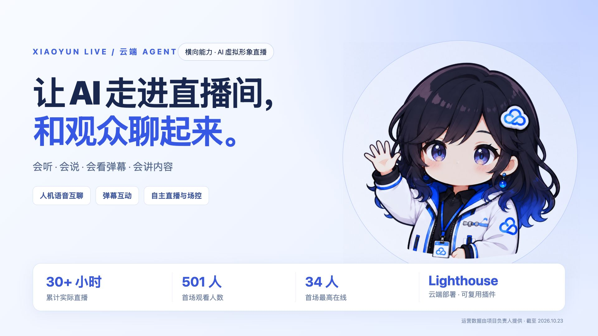
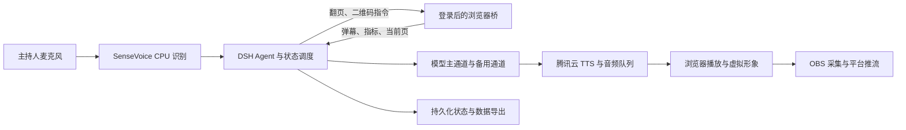

# 小云 Live：AI 虚拟形象直播

小云 Live 把能对话的 Agent、语音、虚拟形象和直播场控连接起来。主持人可以直接与小云说话，观众可以发弹幕参与互动；小云也能围绕演示内容持续讲解，在合适的完整口播之间安排互动、活动与翻页。



[公开交互演示](https://43.129.228.84.sslip.io/live-demo/) · [实现方案](https://43.129.228.84.sslip.io/guide/)

## 能做什么

- **人机语音互聊**：选择麦克风、闭麦、插话打断、服务端识别与语音合成。
- **虚拟形象**：声音驱动嘴部开合，按状态切换表情；绿幕独立展示，供 OBS 抠像。
- **AI 自主直播**：欢迎、讲解、读弹幕、互动引导、活动、翻页、告别组成可观察的状态机。
- **内容讲解**：读取 HTML 演示页的当前页和补充笔记；一页可分多轮讲解，讲完再翻页。也支持纯文字素材。
- **弹幕互动**：批量读取最近两分钟、最多 100 条候选弹幕；可以概括共同问题或点名回应。
- **连续音频**：分句排队，播放时预合成后续片段，并最多预备下一轮；整轮结束后才切换环节。
- **活动场控**：预合成固定口播、弹幕口令选人、定时或指标触发的活动排队、跨页二维码浮层与到期收起。
- **持续运行**：两分钟无音频进度时尝试恢复；自动循环、有界上下文、模型主备、多端共享控制、播报端租约。
- **直播复盘**：采集后台实际可用的指标，导出 JSON、CSV 与 Markdown；缺失值不补造。

网页展示页中的场景切换是交互示意，试听是预合成语音，不连接私人直播间。完整控制台需要登录。虚拟形象使用表情图层与音量驱动嘴部动画，并非音素级口型或三维骨骼动画。

## 快速运行

服务器需要 Docker Compose、可用的模型 API、已开通的腾讯云 TTS，以及公网 HTTPS 域名。语音识别模型使用 CPU，不要求 GPU。

```bash
git clone https://github.com/sliverp/xiaoyun-live.git
cd xiaoyun-live
cp .env.example .env
mkdir -p models
# 在服务器配置 .env，并在仓库之外准备 /etc/xiaoyun-live/tencent-tts.json。
python3 scripts/download_asr.py
docker compose up -d --build
```

`/etc/xiaoyun-live/tencent-tts.json` 的字段为 `secretId` 和 `secretKey`，目录权限应为 0700、文件为 0600。部署步骤见 [部署说明](docs/deployment.md)。程序只通过 `dsh --profile web` 启动 Agent 应用。

在自己的 Mac 安装 [浏览器桥](live-bridge/README.md) 后，扫码进入视频号直播后台；在控制台连接演示页并选择播报端。OBS 捕获演示窗口与独立绿幕人物。开始小云播报不会替你操作视频号开播按钮。

## 架构与案例

- [实现方案与关键取舍](docs/architecture.md)
- [实际使用案例与统计口径](docs/case-study.md)
- [状态节点与转换](plugin/LIVE-STATE.md)
- [持续直播与多端控制](plugin/LIVE-CONTINUITY.md)
- [直播数据与导出](plugin/LIVE-DATA.md)
- [公开发布与凭证保护](docs/security.md)



## 验证

Node.js 22.19 及以上；测试不请求真实模型或 TTS，不需要 API 密钥。

```bash
npm test
npm run check:release
```

虚拟时钟的 48 小时连续调度测试用于验证内存和生命周期，不等于真实直播 48 小时。浏览器网页协议、网络、模型服务及 OBS 仍会影响实际运行。

## 来源与许可

本项目基于 [DeepSeek Harness](https://github.com/deepseek-ai/deepseek-harness) 和 [biliye/dsh-voice-call](https://github.com/biliye/dsh-voice-call) 扩展。语音插件上游版本为 0.2.1、提交 `599be6d5de5c2ee01f5dd859ed8c573060f0cde3`；上游 MIT 版权声明保留在 `plugin/LICENSE`。

本仓库扩展主要涉及直播状态调度、弹幕与指标采集、语音预备队列、虚拟形象、演示控制、活动场控和持续运行。BGM 的 CC0 来源见 `bgm/LICENSE.txt`。小云形象为项目展示素材；涉及的产品名称与标识归各权利人所有，不表示官方背书。

代码采用 [MIT License](LICENSE)。
