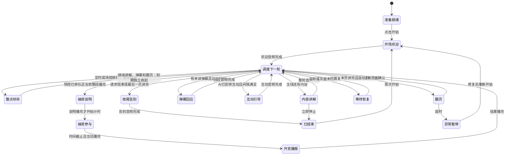

# AI 直播状态与转移

直播有 13 个正常流程节点、2 个等待或异常节点。整点秒杀模式在控制图中用一个秒杀节点替代旧抽奖链路。控制页区分业务状态与执行进度：例如“内容讲解”可处于生成口播、合成音频或播放音频。后端 `live-state.js` 计算的转移条件同时驱动调度与控制页。

控制页默认显示可点选的流程图：亮色节点表示当前状态，紫色虚线表示下一步，灰色箭头表示其他可能路径。箭头标签用简短条件说明何时转移；点节点查看进入条件和后续状态，点箭头标签查看完整转移条件。“跟随当前”返回实时视图。正常循环的返回线只在当前或选中路径显示，等待恢复与异常暂停单独放在图下方。开始、结束和立即停止按钮固定在导演台顶部，详细文字与转移记录可展开查看。

| 状态 | 转移条件 |
| --- | --- |
| 准备就绪 | 素材、提示词、监听已就绪，场控点击开始 → 开场欢迎 |
| 开场欢迎 | 欢迎口播完整播放完成 → 调度下一轮；接管播报不重复开场 |
| 内容讲解 | 本轮所有音频片段播放完成 → 调度下一轮 |
| 弹幕回应 | 这一轮完整播放完成 → 调度下一轮；主线未讲完时下一次回应前至少讲一段内容 |
| 互动引导 | AI 生成的短问题、点赞或分享邀请播放完成 → 调度下一轮 |
| 调度下一轮 | 按手动结束、开场、排队抽奖、连接与页面就绪、弹幕、互动、翻页、内容的顺序选择下一步；已排队抽奖先于末页自动告别 |
| 整点秒杀 | 指定起止时间范围内按设置间隔定时安排或场控排队，完整口播结束后右上角展示二维码，讲解、弹幕与翻页正常继续，截止后独立收起 |
| 抽奖说明 | 场控已排队且当前整段播完 → 说明礼物与口令；说明播完才开始计时 |
| 抽奖参与 | 口播互动、收集新弹幕；参与截止且互动播完 → 开奖播报 |
| 开奖播报 | 第一条完整匹配口令的新弹幕中奖；结果播完 → 调度下一轮 |
| 翻页 | Chrome 确认页面变化 → 调度；12 秒没有变化 → 异常暂停 |
| 收尾告别 | 告别整段音频播放完成 → 已结束 |
| 已结束 | 不再生成音频，BGM 暂停；再次开始 → 开场欢迎 |
| 等待恢复 | 监听或页面恢复后继续；关闭自动翻页时等待场控翻页，也可回应新弹幕 |
| 异常暂停 | 修复错误、点击重新开始 → 开场欢迎；不把失败当作正常告别 |

“暂停”立即暂停当前人声和 BGM，保留音频位置、队列、PPT 页码和已播进度；暂停期间不自动生成、翻页或进入下一个环节。正在请求的未播放文稿会取消，继续后按原进度重新调度；已经暂停的音频从原位置继续。抽奖倒计时同时冻结，继续后保留相同剩余秒数；暂停期间收到的弹幕仍然采集。刷新页面后可重新接回当前轮，浏览器丢失的音频位置会从该轮开头恢复。

“重新开始”取消当前口播、抽奖和预备队列，清空本轮讲解计数、旧弹幕待办，保留奖品池和已发记录，文本幻灯片回到第 1 页；HTML 演示页去掉旧页码锚点后重新打开，等待第 1 页确认，才生成开场欢迎。回第一页失败会显示错误，不在旧页上继续讲开场。新轮次创建独立会话；原会话、直播数据报告和抽奖历史保留，系统提示词、素材、音色、语速、BGM 和节奏设置保持。重播期间再次收到旧消息不会把它们当成新弹幕。

控制接口为 `live-pause`、`live-resume`、`live-restart`；重新开始携带控制端 ownerId，但保留原播报端；显式接管才更换声音输出。三个按钮固定在导演台顶部；暂停后按钮切换为“继续”。暂停时不能安排新抽奖或正常告别，可继续后操作，也可立即停止或重新开始。

“结束整场并告别”保留正在播放的整轮音频，取消尚未播放的模型生成，再生成告别。告别也使用音频队列；最后一片播放完才停止直播并暂停 BGM。“立即停止”直接取消当前音频与生成，不播放告别。`live-stop` 是立即停止，`live-finish` 是正常收尾。语音合成或播放失败时，播报端通过 `live-playback-error` 上报当前 ownerId 与 turnId，控制器验证轮次后进入异常暂停；旧播报端不能停止新轮次。

播报端开始播放一轮的第一片音频时，通过 `live-prepare` 携带当前 ownerId、turnId 和语速，预备下一轮；同轮只触发一次。后台最多保留一段文稿与音频，使用同一会话和主备模型机制生成文本，再按腾讯云的文本限制逐片提前合成。当前节点仍表示正在播放的内容，控制页另显示下一段文本生成、音频合成或就绪进度。已经生成但未播放的内容不能推进页码、已读弹幕或互动计数。

整轮音频完成后仍按原优先级重新调度：方向未变时直接播放已备好的音频；模型尚未返回则接续该请求，不重复生成；音频尚未合成完则等待剩余合成。新弹幕、抽奖、结束请求或页面变化使预备内容失效时，丢弃未播放的内容，按新的条件处理。若预生成的弹幕回应之后又收到新弹幕，段末会根据最新100条未读弹幕更新回应，未播放的预备稿不会标记任何弹幕已读。取消的预生成稿在后续模型请求中明确标注为未播出，避免跳过尚未讲过的要点。

预备失败不会打断当前音频；预合成失败时保留文稿，在轮到它时通过普通语音合成重试。点击结束、立即停止、手动换页或切换直播场次会清理预备结果，迟到结果不再播出。讲完一页的口播不预读尚未打开的下一页，因此翻页确认或临时改为回应弹幕时仍可能有短暂等待。修改语速后，旧倍率的预备音频不会播放，而是按新倍率重新合成。内存事件只保留当前轮的音频数据，结束后释放，不随整场直播累积。

直播口播的模型请求独立使用 `off` 思考强度与 1600 tokens 输出上限，包括恢复的旧会话；普通聊天与全局模型选择不受影响。插件配置 `liveGenerationReasoningEffort`（off/low/high/max）、`liveGenerationMaxTokens`（512–8192）、`liveGenerationTimeoutMs`（1000–120000 毫秒，默认 30000）可调整这些参数。控制页显示本轮已等待秒数、时限和当前生成通道；等待旧调用取消也受此时限约束。模型轮次编号用于排除取消后迟到的旧回复；播报已经开始时不再受生成时限限制。

`liveGenerationFallbacks` 按顺序声明备用 `{provider,model,label}`，最多四项，路由必须已在 DSH 模型设置中配置；密钥由服务端凭据服务解析，不进入控制页。配置备用时，主通道使用 `liveGenerationPrimaryTimeoutMs`（默认 10000 毫秒），备用使用普通生成时限；未配置备用时沿用普通时限。请求错误或超时会切换通道继续同一段口播，当前页面、候选弹幕与音频确认状态不变；一轮中每条通道最多尝试一次，全部失败才异常暂停。已成功的备用会供后续口播继续使用，`liveGenerationCooldownMs`（默认 300000 毫秒）后在下一轮探测主通道；主通道恢复则自动切回，未恢复则继续备用。实际 provider/model 变更由标准 `agent/request` 写入会话请求记录。流程图上方显示当前文案模型和是否正在使用备用。

`liveGenerationFreshSession: true` 在每次从停止状态开始直播时创建独立会话，避免历史直播不断积累到新场次的请求中；旧会话及其记录保留。同场直播的接管、主备切换和后续口播继续使用当前会话，不重复开场。未启用时沿用固定会话。

弹幕条件沿用频率滑块：50% 以上每段可回应，20–45% 每两段、0–15% 每三段可回应；还设有 25–90 秒的等待上限。普通弹幕队列始终最多保留最近100条，每轮读取其中未回应的弹幕。超过上限时丢弃较早的待回应项；生成期间新来的弹幕进入下一轮，但仍受100条上限约束。完整采集数据继续写入直播报告，不受AI回应队列裁剪影响。互动不会推进讲解段数或重置弹幕计数，已到时机的弹幕优先于互动。

互动由 AI 返回可选 `interaction: {type: "question" | "like" | "share", speech: string}` 安排，最多 120 字，与本轮 `speech` 分开。只有两项条件都达到才接收：`engagementMinTurns` 默认 3 段（2–20）、`engagementCooldownSeconds` 默认 90 秒（30–600）。开场与结束可设置 `welcomeScript`、`closingScript` 固定原文，每项最多1200字；非空时直接完整播放，不交给模型改写或截短。匹配已审核文本的预合成录音时直接播放录音；文本或语速改变时按当前设置合成。留空时才使用 `welcomeGuidance`、`closingGuidance` 交给AI生成，身份与事实仍由直播系统提示词和素材限定。

HTML 演示稿通过 `data-slide-number` / `data-slide-count`、进度条页码或 `figure.slide` 传递当前位置。已知页码时用演示地址与页码确定页面身份，同页文字或动画变化不重置讲解进度；翻页后须收到预期的下一页或上一页页码才继续，不能把文字变化当作翻页成功。无页码网页沿用捕获标识确认。可识别末页且自动翻页开启时，AI 返回 `navigation: "next"` 表示讲完：开启自动续播时，控制器回到第一页继续；关闭自动续播时进入告别，不执行下一页。未知总页数的网页由场控点击“结束整场并告别”。

验证：`node --test lib/live-lifecycle.test.mjs lib/live-mode.test.mjs lib/bgm-controller.test.mjs` 覆盖开场、接管、完整音频边界、末页收尾、立即停止、迟到结果、互动间隔、弹幕优先与人声压低 BGM。

生成故障验证：`node --test lib/live-generation.test.mjs lib/generation-failover.test.mjs` 覆盖无响应超时、成功后清理时限、恢复会话的生成参数、上游繁忙、取消完成后生成告别、排除旧轮回复、主备切换、冷却后探测恢复、全部失败和立即停止。

流程图验证：`node --test lib/live-graph.test.mjs` 覆盖当前节点与下一路径、口播返回调度、告别到结束、页面确认与连接恢复，以及保持服务端快照只读。

弹幕口令抽奖的参与窗口、首条匹配规则、取消与持久化行为见 [抽奖说明](LIVE-LOTTERY.md)。

预备队列验证：`node --test lib/live-lookahead.test.mjs lib/live-lookahead-client.test.mjs lib/tencent-tts.test.mjs` 覆盖边播边生成与合成、段末重新检查新弹幕和抽奖、结束时取消、后台超时不打断当前段、不中断整句、语速更新和过期音频释放。

播放控制验证：`node --test lib/live-controls.test.mjs` 覆盖媒体位置保留、暂停生成与音频确认竞态、抽奖计时冻结、重开新会话、旧稿丢弃、HTML 首页确认，以及无效重开请求不影响当前播报。

本场云上AI工坊第36期的固定开场、结束与知识库原文存于 `materials/workshop-36-scripts.json`；开场约40秒、结束约32秒，均使用爱小悠预合成。验证：`node --test lib/live-workshop.test.mjs` 覆盖原文与录音、同页动画、目标页确认和手动翻页边界。

持续直播的自动恢复、循环、上下文清理、多端控制与自动抽奖规则见 [持续直播与多端控制](LIVE-CONTINUITY.md)。

自动秒杀使用北京时间的开始、结束日期时间，开始时刻可触发，结束时刻不再触发。控制台显示未开始、下一场完整日期或已结束；尚未开始的自动排队到结束时间会取消，正在播放的讲解不受影响。
